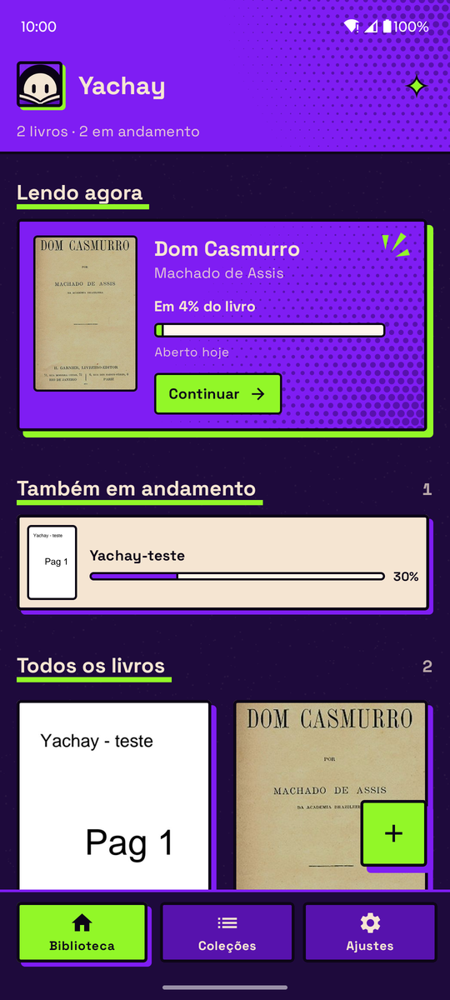
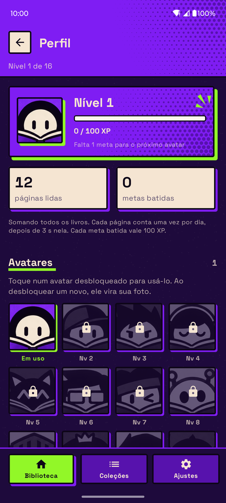
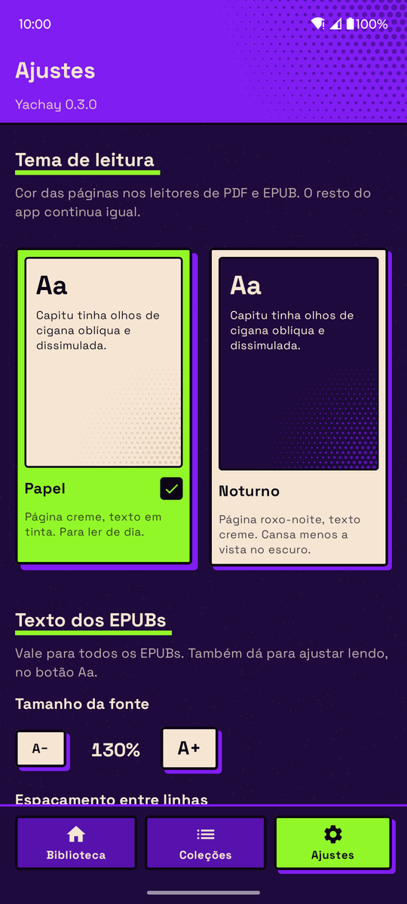

# Yachay

App Android de leitura para PDF e EPUB, com meta diária de páginas, níveis e avatares que você desbloqueia lendo.

*Yachay* significa "saber, aprender" em quéchua.

<p align="center">
  
  
  
  
</p>

## O que ele faz

- **Sua biblioteca, sem copiar arquivos.** Importe PDFs e EPUBs pelo seletor do Android. O arquivo continua onde está; o app só lembra onde ele fica.
- **Onde eu parei?** A Biblioteca abre com o livro que você está lendo, a página atual e um botão para continuar de onde parou.
- **Progresso honesto.** Cada livro guarda o ponto mais longe que você leu. Voltar algumas páginas não apaga o progresso, e um livro terminado continua "Lido".
- **Leitores embutidos.** PDF com zoom por pinça e duplo toque. EPUB com tamanho de fonte, espaçamento entre linhas e tema ajustáveis.
- **Tema de leitura.** Papel (creme, para o dia) ou Noturno (roxo-noite, para o escuro). Vale para os dois leitores.
- **Coleções.** Agrupe livros por tema, autor ou humor e filtre a Biblioteca por coleção.
- **Meta diária.** 10 páginas por dia, somando todos os livros. Uma página conta depois de 3 segundos nela, então folhear rápido não vale.
- **Níveis e avatares.** Cada meta batida rende 100 XP. Subir de nível desbloqueia um dos 16 avatares, e você escolhe qual usar como foto de perfil. O Perfil mostra também quantas páginas você já leu e os últimos livros abertos.

## Instalar

Baixe o APK da [última release](https://github.com/ZaxFelipe/Yachay-Reading-App/releases/latest) e abra no celular. O Android vai pedir permissão para instalar apps de fora da Play Store.

Requer Android 8.0 ou mais novo. O app não pede permissão de armazenamento: todo acesso a arquivos passa pelo seletor do sistema.

## Compilar

Requisitos: JDK 17 e Android SDK com `platforms/android-35`. Aponte o `sdk.dir` no `local.properties`.

```bash
./gradlew assembleDebug        # APK em app/build/outputs/apk/debug/
./gradlew installDebug         # instala no aparelho conectado
./gradlew testDebugUnitTest    # testes unitários
```

Feito em Kotlin com Jetpack Compose. O EPUB usa o [Readium Kotlin Toolkit](https://github.com/readium/kotlin-toolkit); o PDF usa o `PdfRenderer` do próprio Android.
